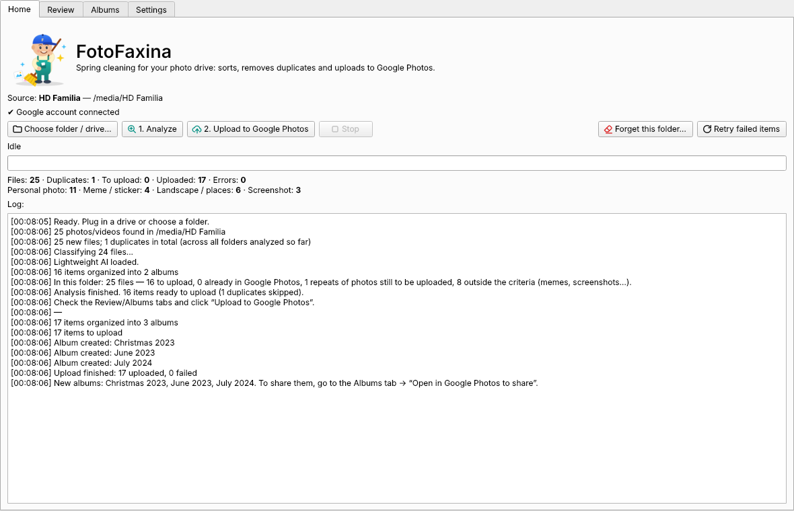
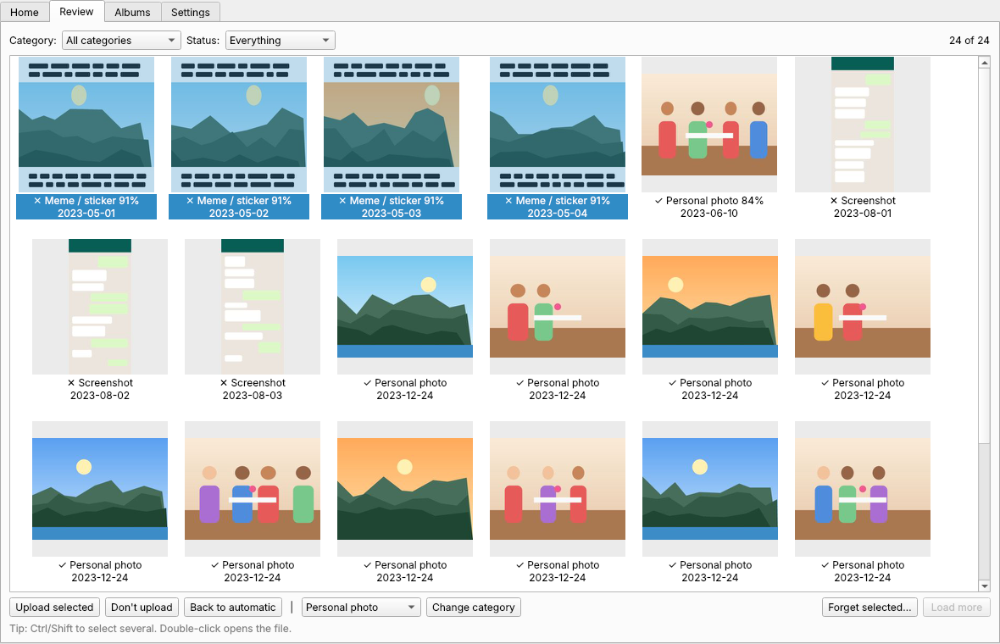
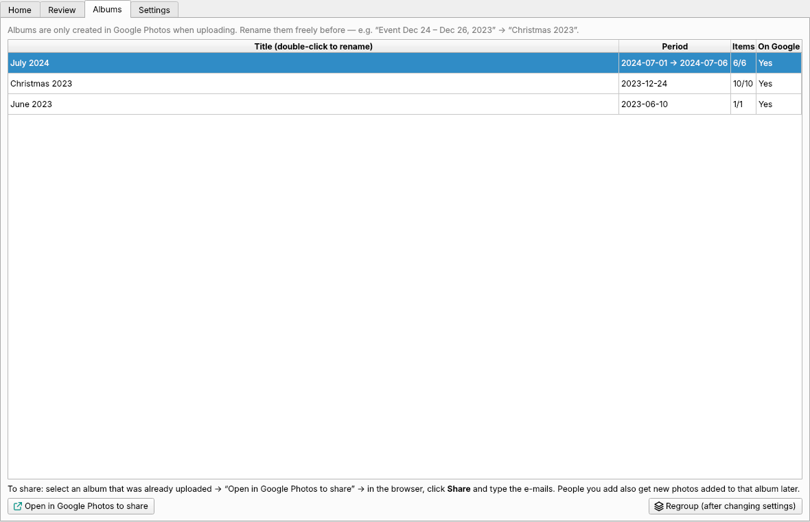
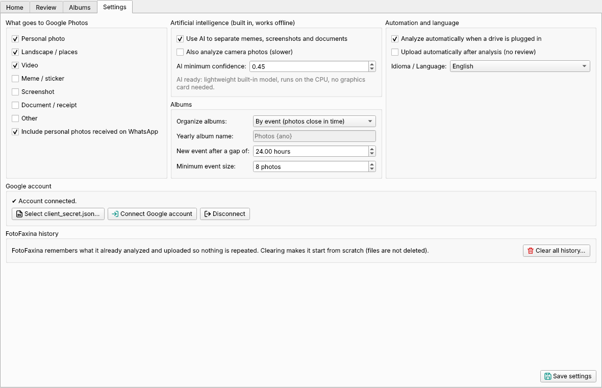
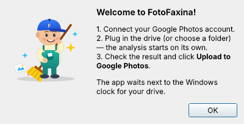

<p align="center">
  
</p>

<h1 align="center">FotoFaxina</h1>

<p align="center">
  <b>Plug in your drive and let it work.</b><br>
  <a href="README.md">🇧🇷 Português</a> · 🇺🇸 English
</p>

FotoFaxina (“photo cleanup” in Portuguese) tidies up the photos on your hard drive: it tells real
photos apart from memes, screenshots, stickers and documents, removes duplicates, builds albums
(by event, month or year) and uploads them to Google Photos. Available in English and Portuguese,
on Windows (installer), Linux and macOS.

## Screenshots

| Home | Review |
|---|---|
|  |  |
| **Albums** | **Settings** |
|  |  |

<p align="center"></p>

## Install (end users)

1. Go to **[Releases](https://github.com/sfidencio/fotofaxina/releases/latest)** and download
   `FotoFaxina-Setup-x.y.z.exe`.
2. Open it. If you see “Windows protected your PC”, click
   **More info → Run anyway** (the installer is not digitally signed).
3. Click through to the end. No administrator password or Python needed.
4. On first launch FotoFaxina offers to connect your Google account. After that, just plug in the drive.

The app waits next to the Windows clock and starts analyzing as soon as a drive is plugged in.
To uninstall: Windows Settings → Apps → FotoFaxina.

## How it works

> 🔒 **Your files stay untouched.** FotoFaxina only **reads** the drive: it never deletes, moves,
> renames or modifies any source file — not even duplicates or memes. Everything it writes
> (database, thumbnails, settings) goes to its own data folder (`~/.fotofaxina`). An automated
> test checks this on every release (`tests/test_origem_intocada.py`).

1. **Drive plugged in** → the app notices and starts the analysis on its own.
2. **Scan**: reads every file, computes a hash (exact duplicates) and a perceptual hash (the same
   photo re-sent/recompressed by WhatsApp), and reads the date and camera from EXIF.
   Nearly identical photos taken in sequence (burst, changing light) are **not** treated as
   copies when the camera recorded different times.
3. **Classification**:
   - **Fast rules**: `IMG-20240101-WA0001.jpg` = WhatsApp, `Screenshot_…` = screenshot, WhatsApp
     `.webp` = sticker, tiny images = icons/junk, photo with camera EXIF = photo.
   - **Lightweight built-in AI** for the rest (WhatsApp images and unknown sources): personal
     photo, landscape, meme, screenshot or document. See below.
4. **Albums** — choose in Settings → “Organize albums”:
   - **By event** (default): photos close in time (no gap longer than 24h, 8+ photos) become
     “Event Dec 24 – Dec 26, 2023”; the rest goes to the month album. Photos from the same
     event analyzed later (e.g. your spouse's phone) go into the album already uploaded.
   - **By month**: “December 2023”.
   - **By year**: “Photos 2023” (name is configurable). Ideal for drives already organized in
     `2020/`, `2021/`… folders. The photo's real date (EXIF or file name) wins; without one, the
     folder year is used (`2021/Wife's phone/photo.jpg` → 2021); with neither, it goes to
     “Photos without date”.
5. **Review** (optional): thumbnail grid with filters. Select and mark
   “Upload” / “Don't upload” / “Change category”. If a similar photo was treated as a copy
   but isn't one, use **Not a duplicate**: it will be uploaded, and this sticks in later analyses.
6. **Upload**: creates the albums and uploads in batches of 50. Everything is recorded in a local
   database; you can stop, turn off the PC, plug the drive in with another letter and continue
   where it left off, never uploading anything twice. If the internet drops, it retries; if one
   batch fails, the others continue. Photos on a drive that isn't plugged in wait, without errors.

## Artificial intelligence (light, offline, no graphics card)

FotoFaxina uses OpenAI's **CLIP** model converted to **ONNX** and quantized to int8: about 90 MB
bundled in the installer, running on the CPU with **ONNX Runtime** (~15 MB) — instead of the
~2 GB of PyTorch. Your photos **never leave your computer** to be classified.

- **Turn it on/off**: Settings → *Use AI to separate memes, screenshots and documents*.
  When off, only the rules are used (WhatsApp images become “Other” for you to decide).
- By default the AI only looks at WhatsApp and unknown-source images — camera photos are almost
  always photos. To analyze everything: *Also analyze camera photos (slower)*.
- Turned the AI on or downloaded the model after the first analysis? The next analysis redoes
  what was decided without it (WhatsApp photos left as “Other”).
- Fine tuning: *AI minimum confidence*. Items below it show up under the **Low confidence**
  filter in the Review tab.

## Google credential (one time, ~10 minutes)

Google requires every program to have its own credential. Summary:

1. Open https://console.cloud.google.com/
2. Create a project named `FotoFaxina`.
3. Enable the **Photos Library API**.
4. In **Google Auth Platform** → **Get started**: app name, your e-mail, audience **External**.
5. In **Audience** → **Test users**: add your Gmail (and anyone else who will use it).
6. In **Clients** → **Create client** → type **Desktop app** → download the JSON.
7. In FotoFaxina: **Settings** → **Select client_secret.json** → **Connect Google account**.
   On the “Google hasn't verified this app” screen, click **Continue**.

👉 **Full step-by-step guide with common errors: [docs/GOOGLE-SETUP.md](docs/GOOGLE-SETUP.md)**

> While the app is in testing mode in Google Cloud, the sign-in expires every 7 days.
> When it does, just click **Connect Google account** again.

## Google Photos API limitations (important)

- Since 2025-03-31 the API **only sees what the app itself uploaded**. Duplicate checking covers
  everything that went through FotoFaxina, not photos you uploaded manually before.
- Photos can only be added to **albums created by the app**. Your existing albums are untouched.
- API uploads are stored in **original quality and count toward your Google storage**.
- There is a **daily request limit**. If it is reached the app stops and tells you; the next day,
  click Upload and it continues where it left off.

## Sharing albums and making sure your family has access

Since 2025-03-31 the Google API no longer lets programs share albums. So FotoFaxina takes the
shortest path: in the **Albums** tab, select an uploaded album and click
**Open in Google Photos to share** → in the browser, **Share** → type the e-mails.
Photos added to that album later show up automatically for everyone already added.

So nobody depends on your account, also set up in Google (one time):
- **Inactive Account Manager** (myaccount.google.com → Data & privacy): up to 10 people receive a
  link to download your photos if the account stays inactive for the period you choose.
- **Partner sharing** in the Google Photos app: the other person receives everything
  automatically and can save a copy to their own account.

## History (forgetting records)

FotoFaxina remembers what it already analyzed and uploaded so nothing is repeated. To redo something:
- **Review → Forget selected…**: only the selected items.
- **Home → Forget this folder…**: every record of the chosen folder.
- **Settings → Clear all history…**: start from scratch.

None of this deletes files from your computer or from Google Photos. FotoFaxina forgets the
analysis but **keeps remembering what is already in Google Photos** (the albums it created and a
fingerprint of each uploaded photo): after clearing, nothing is uploaded again and new photos go to
the albums that already exist — e.g. “part 2” of 2023 goes into the same “Photos 2023”. To forget that
too (only useful if you switched Google accounts), tick the extra option in the clear warning.

## Language

The app opens in the system language (English or Portuguese). To change it: Settings →
**Idioma / Language** → Save → close and reopen FotoFaxina.

## Everyday use

- Closing the window only hides the app next to the clock. To quit: tray icon → **Quit**.
- **First time**: keep “Upload automatically” off, run an analysis, check the Review tab
  (“Low confidence” filter) and adjust. Once you trust the result, turn automatic upload on and
  the whole flow becomes “plug in the drive”.

## Code signing policy

Free code signing provided by [SignPath.io](https://about.signpath.io/), certificate by
[SignPath Foundation](https://signpath.org/).

- Committers and reviewers: [sfidencio](https://github.com/sfidencio)
- Approvers: [sfidencio](https://github.com/sfidencio)

Installers are built automatically by GitHub Actions from this repository
(`.github/workflows/release.yml`) and every signed release is approved manually.

### Privacy

FotoFaxina will not transfer any information to other networked systems unless specifically
requested by the user. Photos are analyzed on your own computer (the AI runs locally). The only
network communication is with **Google Photos**, to upload the photos and create the albums you
chose, after you connect your Google account and click Upload. The sign-in is stored only on your
computer (`~/.fotofaxina/token.json`, protected by Windows encryption) and can be removed in Settings → Disconnect.

## License

[MIT](LICENSE). The AI model is OpenAI's CLIP (MIT license).

---

## For developers

### Running from source

Requires Python 3.10+.

```bash
python -m venv .venv
# Windows: .venv\Scripts\activate   |   Linux/Mac: source .venv/bin/activate
pip install -r requirements.txt
python main.py
```

Without the model the app runs with rules only. The easiest way to get the AI when running from
source is **Settings → Download AI model** (or `python main.py --baixar-ia`): it downloads the
ready-made model from the latest release (~96 MB) into `~/.fotofaxina/models`. To build it yourself:

```bash
pip install torch --index-url https://download.pytorch.org/whl/cpu
pip install -r packaging/requirements-model.txt
python packaging/build_model.py      # creates models/ (~90 MB)
```

### Releasing a new installer

GitHub Actions (`.github/workflows/release.yml`) does everything on a cloud Windows machine:
builds the AI model, PyInstaller, the Inno Setup installer (English and Portuguese) and publishes
to Releases.

**Just bump the number in `app/__init__.py`** (e.g. `1.1.0` → `1.1.1`) and push to `master`.
Pushes that don't change the number don't create a release.

**Bundled credential (recommended):** add the contents of `client_secret.json` under
**Settings → Secrets and variables → Actions** as `GOOGLE_CLIENT_SECRET_JSON`
(details in [docs/GOOGLE-SETUP.md](docs/GOOGLE-SETUP.md)).

### Translations

Source text is Portuguese, marked with `_("...")`. English translations live in
`app/i18n_en.py`. `python packaging/check_i18n.py` lists missing translations (the build fails
if any are missing).

### Command line and data

```bash
python main.py --cli /path/to/drive            # analyze only
python main.py --cli /path/to/drive --enviar   # analyze and upload
```

Data lives in `~/.fotofaxina/` (`C:\Users\<you>\.fotofaxina\`): `biblioteca.sqlite`,
`config.json`, `token.json`, `miniaturas/`, `fotofaxina.log`.
