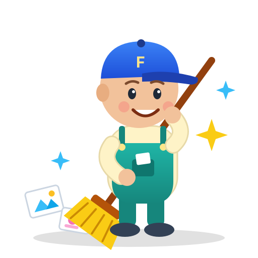
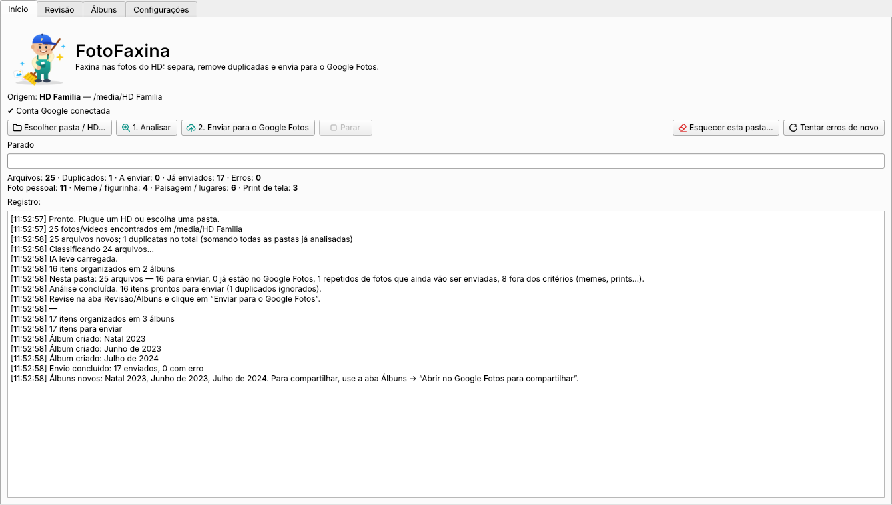
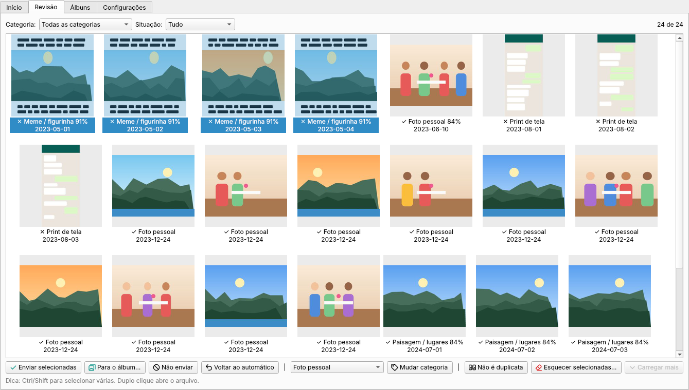
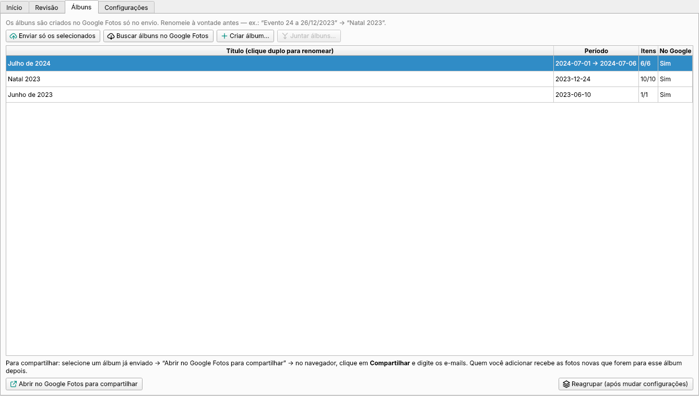
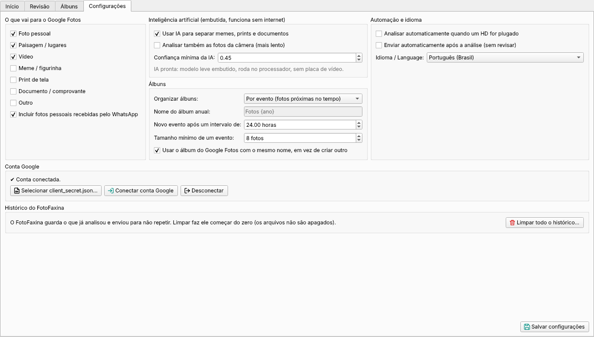
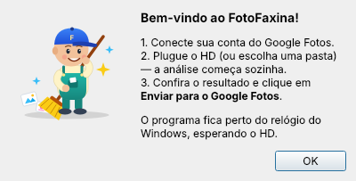

<p align="center">
  
</p>

<h1 align="center">FotoFaxina</h1>

<p align="center">
  <b>Plugue o HD e deixe trabalhar.</b><br>
  🇧🇷 Português · <a href="README.en.md">🇺🇸 English</a>
</p>

O FotoFaxina faz a faxina nas fotos do seu HD: separa o que é foto de verdade do que é meme,
print, figurinha e documento, remove duplicadas, monta álbuns (por evento, mês ou ano) e envia
para o Google Fotos. Funciona em português e inglês, no Windows (zip, sem instalar), Linux e macOS.

## Telas

| Início | Revisão |
|---|---|
|  |  |
| **Álbuns** | **Configurações** |
|  |  |

<p align="center"></p>

## Instalar (usuário final)

Não tem instalador: é um zip com tudo dentro (inclusive o Python).

1. Vá em **[Releases](https://github.com/sfidencio/fotofaxina/releases/latest)** e baixe
   `FotoFaxina-x.y.z-windows.zip`.
2. Antes de extrair: botão direito no zip → **Propriedades** → marque **Desbloquear** → OK.
3. Botão direito → **Extrair tudo…** (ex.: em `Documentos\FotoFaxina`).
4. Abra a pasta extraída e dê dois cliques em **FotoFaxina.cmd**. Se não abrir, use
   **FotoFaxina-diagnostico.cmd**, que mostra a mensagem de erro.

O zip não tem executável próprio: traz o **Python oficial do python.org** (assinado pela Python
Software Foundation, por isso os antivírus não reclamam) e o código-fonte do FotoFaxina.
5. No primeiro uso o FotoFaxina oferece conectar sua conta Google. Depois: escolha a pasta → **Analisar**.

Para atualizar, extraia a versão nova por cima. O histórico e o login ficam em
`C:\Users\<você>\.fotofaxina` e são mantidos.

O programa fica perto do relógio do Windows. Para ele analisar sozinho quando um HD for plugado,
ligue a opção em Configurações (vem desligada).
Para remover: apague a pasta extraída (e, se quiser, a pasta `.fotofaxina` com o histórico).

## Como funciona

> 🔒 **Seus arquivos ficam intactos.** O FotoFaxina só **lê** o HD: nunca apaga, move, renomeia
> ou altera nenhum arquivo de origem — nem as duplicatas, nem os memes. Tudo o que ele grava
> (banco, miniaturas, configurações) fica na pasta de dados dele (`~/.fotofaxina`). Um teste
> automático confere isso a cada versão (`tests/test_origem_intocada.py`).

1. **Escolha a pasta ou o HD** e clique em **Analisar**. (Para analisar sozinho ao plugar o HD,
   ligue em Configurações → *Analisar automaticamente quando um HD for plugado*; vem desligado.)
2. **Varredura**: lê cada arquivo, calcula hash (duplicata exata) e hash perceptual
   (a mesma foto reenviada/recomprimida pelo WhatsApp), lê data e câmera do EXIF.
   Fotos em sequência quase iguais (rajada, a luz mudando) **não** são tratadas como cópia
   quando a câmera gravou horários diferentes.
3. **Classificação**:
   - **Regras rápidas**: `IMG-20240101-WA0001.jpg` = WhatsApp, `Screenshot_…` = print,
     `.webp` do WhatsApp = figurinha, imagens minúsculas = ícone/lixo, foto com EXIF de câmera = foto.
   - **IA leve embutida** para o que sobrar (imagens do WhatsApp e de origem desconhecida):
     foto pessoal, paisagem, meme, print ou documento. Veja abaixo.
4. **Álbuns** — escolha em Configurações → “Organizar álbuns”:
   - **Por evento** (padrão): fotos próximas no tempo (sem intervalo maior que 24h e com 8+
     fotos) viram “Evento 24 a 26/12/2023”; o resto vai para o álbum do mês. Fotos do mesmo
     evento analisadas depois (ex.: o celular da esposa) entram no álbum que já foi enviado.
   - **Por mês**: “Dezembro de 2023”.
   - **Por ano**: “Fotos 2023” (nome configurável). Ideal para HDs organizados em pastas
     `2020/`, `2021/`… A data real da foto (EXIF ou nome do arquivo) manda; sem data, vale o
     ano da pasta (`2021/Celular da esposa/foto.jpg` → 2021); sem nenhum dos dois, vai para
     “Fotos sem data”.
5. **Revisão** (opcional): grade de miniaturas com filtros. Selecione e marque
   “Enviar” / “Não enviar” / “Mudar categoria”. Se uma foto parecida foi tratada como cópia
   sem ser, use **Não é duplicata**: ela passa a ser enviada e isso vale nas próximas análises.
6. **Envio**: cria os álbuns e sobe as fotos em lotes de 50. Tudo fica registrado num banco
   local; dá para parar, desligar o PC, plugar o HD em outra letra e continuar de onde parou,
   sem enviar nada duas vezes. Se a internet oscilar, ele tenta de novo; se um lote falhar, os
   outros continuam. Fotos de um HD que não está plugado ficam esperando, sem virar erro.

## Inteligência artificial (leve, sem internet, sem placa de vídeo)

O FotoFaxina usa o modelo **CLIP** (OpenAI) convertido para **ONNX** e compactado em int8:
cerca de 90 MB embutidos no pacote, rodando no processador com o **ONNX Runtime**
(~15 MB) — em vez dos ~2 GB do PyTorch. As fotos **nunca saem do seu computador** para serem
classificadas.

- **Ligar/desligar**: Configurações → *Usar IA para separar memes, prints e documentos*.
  Desligada, o app usa só as regras (imagens do WhatsApp ficam como “Outro” para você decidir).
- Por padrão a IA analisa só imagens do WhatsApp e de origem desconhecida — foto de câmera
  quase sempre é foto. Para analisar tudo: *Analisar também as fotos da câmera (mais lento)*.
- Ligou a IA ou baixou o modelo depois da primeira análise? Na próxima análise ela refaz o
  que tinha sido decidido sem ela (fotos do WhatsApp que ficaram como “Outro”).
- Ajuste fino: *Confiança mínima da IA*. Itens abaixo dela aparecem no filtro
  **Baixa confiança** da aba Revisão.

## Credencial do Google (uma vez só, ~10 minutos)

O Google exige que cada programa tenha uma credencial própria. Resumo:

1. Abra o Google Cloud já em português: https://console.cloud.google.com/?hl=pt-BR
2. Crie um projeto chamado `FotoFaxina`.
3. Ative a **Photos Library API**.
4. Em **Google Auth Platform** → **Primeiros passos**: nome do app, seu e-mail, público **Externo**.
5. Em **Público-alvo** → **Usuários de teste**: adicione o seu Gmail (e de quem mais for usar).
6. Em **Clientes** → **Criar cliente** → tipo **App para computador** → baixe o JSON.
7. No FotoFaxina: **Configurações** → **Selecionar client_secret.json** →
   **Conectar conta Google**. Na tela “O Google não verificou este app”, clique em **Continuar**.

👉 **Passo a passo completo, com os nomes dos botões em português e em inglês e solução dos
erros mais comuns: [docs/CONFIGURAR-GOOGLE.md](docs/CONFIGURAR-GOOGLE.md)**

> Enquanto o app estiver em modo de teste no Google Cloud, o login expira a cada 7 dias.
> Quando expirar, é só clicar em **Conectar conta Google** de novo.

## Limitações da API do Google Fotos (importantes)

- Desde 31/03/2025 a API **só enxerga o que o próprio app enviou**. A checagem de duplicatas
  vale para tudo que passou pelo FotoFaxina, não para fotos que você subiu antes manualmente.
- Fotos só podem ir para **álbuns criados pelo app**. Seus álbuns antigos não mudam.
- Uploads pela API ficam em **qualidade original e contam no armazenamento** da conta Google.
- Existe um **limite diário de requisições**. Se for atingido, o app avisa e para; no dia
  seguinte, clique em Enviar e ele continua de onde parou.

## Enviar por partes e conferir o que já foi

- **Início → 2. Enviar tudo para o Google Fotos:** envia tudo o que está pendente, de todas as pastas.
- **Início → Enviar só esta pasta:** só os arquivos da pasta/HD escolhido.
- **Álbuns → Enviar só os selecionados:** só os álbuns marcados (ex.: “Fotos 2023”).
- **Início → Conferir com o Google Fotos:** descobre o que já está no Google Fotos (pelo nome do
  arquivo, dimensões e data das fotos que o FotoFaxina enviou) e deixa para enviar só o que falta.
  Útil depois de limpar o histórico. O nome de cada arquivo que der erro no envio fica registrado
  no `fotofaxina.log`, e o app avisa antes de limpar o histórico se houver fotos com erro.

## Álbuns no Google Fotos

- **Mesmo nome, mesmo álbum:** antes de criar um álbum, o FotoFaxina procura no Google Fotos um
  álbum **criado por ele** com o mesmo nome e usa esse (ex.: a “parte 2” de 2023 entra no
  “Fotos 2023” que já existe, mesmo depois de limpar o histórico). Dá para desligar em
  Configurações → Álbuns.
- **Escolher o álbum:** na Revisão, selecione fotos → **Para o álbum…** → escolha um álbum da lista
  ou **Criar álbum novo…** (criado na hora no Google Fotos). Fotos já enviadas são movidas para o
  álbum escolhido no próximo envio.
- **Aba Álbuns:** **Buscar álbuns no Google Fotos**, **Criar álbum…** e **Juntar álbuns…**
  (selecione dois ou mais com Ctrl+clique; as fotos vão para um só e os outros ficam vazios — o
  Google não deixa apps apagarem álbuns, então apague os vazios no Google Fotos; as fotos não são
  apagadas).
- **Álbum cheio:** o Google aceita até 20.000 itens por álbum; ao encher, o envio continua sozinho
  em “Fotos 2023 (2)”.
- **Limite do Google:** só os álbuns criados pelo FotoFaxina aparecem e podem receber fotos.
  Álbuns feitos à mão no Google Fotos não são acessíveis a outros apps.
- Quem já usava uma versão anterior precisa clicar uma vez em **Conectar conta Google** para liberar
  a lista de álbuns (o envio continua funcionando mesmo sem isso).

## Compartilhar álbuns e garantir acesso da família

Desde 31/03/2025 a API do Google não permite mais compartilhar álbuns por programa. Por isso o
FotoFaxina faz o caminho mais curto: na aba **Álbuns**, selecione um álbum já enviado e clique em
**Abrir no Google Fotos para compartilhar** → no navegador, **Compartilhar** → digite os e-mails.
Fotos enviadas depois para o mesmo álbum aparecem automaticamente para quem já foi adicionado.

Para que ninguém fique dependente da sua conta, configure também no Google (uma vez só):
- **Gerenciador de contas inativas** (myaccount.google.com → Dados e privacidade): até 10 pessoas
  recebem o link para baixar suas fotos se a conta ficar inativa pelo prazo que você escolher.
- **Compartilhamento com parceiro** no app Google Fotos: a outra pessoa recebe tudo
  automaticamente e pode salvar uma cópia na conta dela.

## Histórico (esquecer registros)

O FotoFaxina lembra o que já analisou e enviou para não repetir. Para refazer algo:
- **Revisão → Esquecer selecionadas…**: só os itens marcados.
- **Início → Esquecer esta pasta…**: todos os registros da pasta escolhida.
- **Configurações → Limpar todo o histórico…**: começa do zero.

Nada disso apaga arquivos do computador ou do Google Fotos. Depois de esquecer, o que já tinha
sido enviado pode ser enviado de novo (ficando repetido no Google Fotos).

## Idioma

O app abre no idioma do sistema (português ou inglês). Para trocar: Configurações →
**Idioma / Language** → Salvar → feche e abra o FotoFaxina.

## Uso no dia a dia

- Fechar a janela só esconde o app perto do relógio. Para sair: ícone da bandeja → **Sair**.
- **Primeira vez**: deixe “Enviar automaticamente” desligado, rode uma análise, confira a aba
  Revisão (filtro “Baixa confiança”) e ajuste. Quando confiar no resultado, ligue o envio
  automático e o fluxo vira só “plugar o HD”.

## Política de assinatura de código (Code signing policy)

Assinatura de código gratuita fornecida por [SignPath.io](https://about.signpath.io/),
certificado da [SignPath Foundation](https://signpath.org/).

- Autores e revisores (committers): [sfidencio](https://github.com/sfidencio)
- Aprovador das assinaturas: [sfidencio](https://github.com/sfidencio)

Os pacotes são gerados automaticamente pelo GitHub Actions a partir deste repositório
(`.github/workflows/release.yml`) e cada versão assinada é aprovada manualmente.

### Privacidade

O FotoFaxina não envia nenhuma informação para outros sistemas sem que você peça. As fotos são
analisadas no seu próprio computador (a IA roda localmente). A única comunicação de rede é com o
**Google Fotos**, para enviar as fotos e criar os álbuns que você escolheu, depois que você conecta
sua conta Google e clica em Enviar. O login fica salvo só no seu computador
(`~/.fotofaxina/token.json`, protegido pela criptografia do Windows) e pode ser removido em Configurações → Desconectar.

## Licença

[MIT](LICENSE). O modelo de IA usado é o CLIP da OpenAI (licença MIT).

---

## Para desenvolvedores

### Rodar a partir do código

Requer Python 3.10+.

```bash
python -m venv .venv
# Windows: .venv\Scripts\activate   |   Linux/Mac: source .venv/bin/activate
pip install -r requirements.txt
python main.py
```

Sem o modelo o app funciona só com as regras. Para ter a IA rodando pelo código, o mais fácil é
**Configurações → Baixar modelo de IA** (ou `python main.py --baixar-ia`): baixa o modelo pronto
da última versão (~96 MB) para `~/.fotofaxina/models`. Para gerar o modelo você mesmo:

```bash
pip install torch --index-url https://download.pytorch.org/whl/cpu
pip install -r packaging/requirements-model.txt
python packaging/build_model.py      # cria models/ (~90 MB)
```

### Gerar uma nova versão

O GitHub Actions (`.github/workflows/release.yml`) faz tudo num Windows na nuvem: gera o modelo
de IA, o zip para Windows (Python oficial embutido + código) e publica em Releases.

**Basta mudar o número em `app/__init__.py`** (ex.: `1.1.0` → `1.1.1`) e dar push na `master`.
Pushes que não mudam o número não geram versão nova.

**Credencial embutida (recomendado):** cadastre o conteúdo do `client_secret.json` em
**Settings → Secrets and variables → Actions** com o nome `GOOGLE_CLIENT_SECRET_JSON`
(detalhes em [docs/CONFIGURAR-GOOGLE.md](docs/CONFIGURAR-GOOGLE.md)).

### Traduções

O texto-fonte é o português, marcado com `_("...")`. As traduções para inglês ficam em
`app/i18n_en.py`. `python packaging/check_i18n.py` aponta textos sem tradução (o build falha
se faltar alguma).

### Linha de comando e dados

```bash
python main.py --cli /caminho/do/hd            # só analisa
python main.py --cli /caminho/do/hd --enviar   # analisa e envia
```

Dados em `~/.fotofaxina/` (`C:\Users\<você>\.fotofaxina\`): `biblioteca.sqlite`, `config.json`,
`token.json`, `miniaturas/`, `fotofaxina.log`.

### Estrutura

```
main.py                    entrada (janela, --minimizado, --cli)
app/config.py              configurações e regra "vai ou não para o Google"
app/scanner.py             varredura, hashes, EXIF, datas, duplicatas
app/classifier.py          regras + IA (CLIP em ONNX)
app/ai_prompts.py          descrições de cada categoria usadas pela IA
app/grouper.py             álbuns por evento, mês ou ano
app/google_photos.py       OAuth + upload + álbuns (Photos Library API)
app/pipeline.py            orquestra as etapas (retomável)
app/i18n.py, i18n_en.py    tradução PT-BR / EN
app/gui/                   janela, abas, tarefas em segundo plano
assets/                    mascote e ícone (SVG + PNG/ICO gerados por packaging/render_assets.py)
packaging/                 modelo de IA, ícones, checagem de traduções
```
